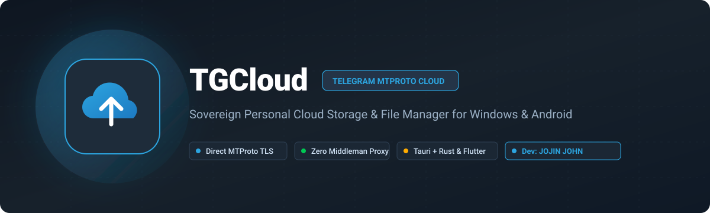
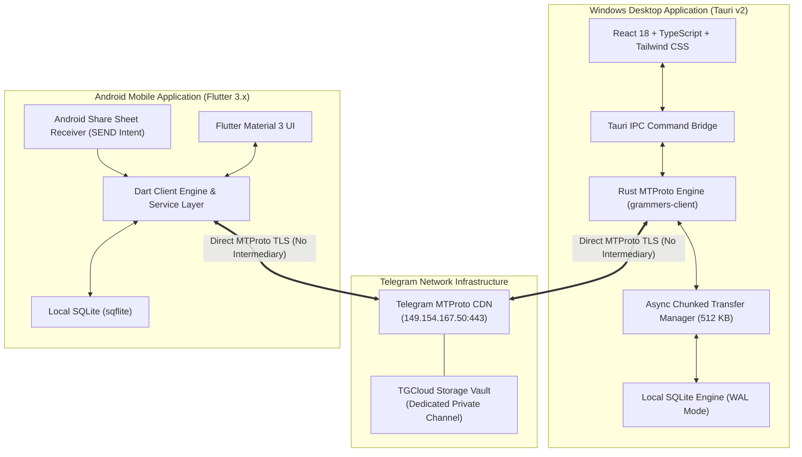

> [!NOTE]
> **Direct Telegram MTProto Architecture:** TGCloud connects directly from your local client to official Telegram MTProto datacenters. No intermediate servers, no telemetry, and no third-party proxies. Your files remain 100% sovereign.

<div align="center">



<br/>

[](#about-the-developer)
[](#architecture)
[-1e2c3a?style=for-the-badge&logo=windows&logoColor=white)](#download--get-started)
[-02569B?style=for-the-badge&logo=android&logoColor=white)](#download--get-started)
[](#license)
[](https://www.linkedin.com/in/jojin-john/)

### TGCloud is an autonomous, direct personal cloud-storage and file-management system powered by Telegram MTProto.

It turns your personal Telegram account into a sovereign, high-speed, unlimited cloud drive. Browse folders, stream media, search instantly, and execute real chunked transfers without opening Telegram. **No mock data, no proxy servers.**

**This repository is TGCloud: the full open-source client suite for Windows and Android, engineered and developed by JOJIN JOHN.**

<br/>

<p>
  <a href="https://github.com/jojin1709/tgcloud/releases/latest"></a>
  &nbsp;&nbsp;&nbsp;&nbsp;&nbsp;&nbsp;
  <a href="https://github.com/jojin1709/tgcloud/releases/latest"></a>
</p>

<sub>Pre-compiled, fully functional standalone releases. Simply download, launch, and connect with Telegram. No terminal or compilers required.</sub>

---

<p>
  <a href="#download--get-started"><b>Download &amp; Get Started</b></a>&nbsp;&nbsp;•&nbsp;&nbsp;
  <a href="#key-capabilities"><b>Key Capabilities</b></a>&nbsp;&nbsp;•&nbsp;&nbsp;
  <a href="#architecture"><b>Architecture</b></a>&nbsp;&nbsp;•&nbsp;&nbsp;
  <a href="#security--privacy"><b>Security &amp; Privacy</b></a>&nbsp;&nbsp;•&nbsp;&nbsp;
  <a href="#documentation"><b>Documentation</b></a>&nbsp;&nbsp;•&nbsp;&nbsp;
  <a href="#about-the-developer"><b>About the Developer</b></a>&nbsp;&nbsp;•&nbsp;&nbsp;
  <a href="#common-questions"><b>Common Questions</b></a>
</p>

---

</div>

> [!TIP]
> **Zero Setup Hassle:** Just download the executable or APK from [Releases](https://github.com/jojin1709/tgcloud/releases/latest), open it, enter your phone number, and verify with your Telegram login code. Your storage is ready in seconds.

---

## Table of Contents

- [What is TGCloud?](#what-is-tgcloud)
  - [Why TGCloud Exists](#why-tgcloud-exists)
  - [Why Telegram as Storage?](#why-telegram-as-storage)
  - [Zero-Backend Sovereign Architecture](#zero-backend-sovereign-architecture)
- [Download & Get Started](#download--get-started)
  - [1. Download Pre-Built Binaries](#1-download-pre-built-binaries)
  - [2. Quick Login (Under 30 Seconds)](#2-quick-login-under-30-seconds)
- [TGCloud in Action](#tgcloud-in-action)
- [Key Capabilities](#key-capabilities)
- [Architecture](#architecture)
  - [System Flow](#system-flow)
  - [Cross-Platform Technology Matrix](#cross-platform-technology-matrix)
  - [Transfer Pipeline & Telemetry](#transfer-pipeline--telemetry)
- [Security & Privacy](#security--privacy)
- [Documentation](#documentation)
- [Monorepo Structure](#monorepo-structure)
- [About the Developer](#about-the-developer)
- [Common Questions](#common-questions)
  - [Does TGCloud upload real files to Telegram?](#does-tgcloud-upload-real-files-to-telegram)
  - [Are my Telegram cloud passwords saved on disk?](#are-my-telegram-cloud-passwords-saved-on-disk)
  - [Does TGCloud clutter my Saved Messages?](#does-tgcloud-clutter-my-saved-messages)
  - [What is the maximum file size supported?](#what-is-the-maximum-file-size-supported)
  - [Can I share files to TGCloud from Android Gallery?](#can-i-share-files-to-tgcloud-from-android-gallery)
- [License](#license)

---

## What is TGCloud?

TGCloud is a personal cloud-storage and file-management system engineered for Windows and Android. It transforms your personal Telegram account into a private, sovereign, high-speed, direct cloud drive.

Every file uploaded through TGCloud streams directly to Telegram datacenters using official MTProto client protocol primitives. Directory structures, virtual folders, file tags, and local transfer queues are indexed locally using high-performance SQLite in WAL mode.

<a id="why-tgcloud-exists"></a>
<details>
<summary><strong>Why TGCloud Exists</strong></summary>

Mainstream commercial cloud drives enforce steep recurring fees, strict storage quotas, bandwidth throttles, and automated file-scanning algorithms. Meanwhile, Telegram provides generous file storage (up to 2 GB per file for free accounts, 4 GB for Premium) backed by high-capacity global CDN infrastructure.

TGCloud bridges the gap: it provides a commercial-grade cloud-drive interface—complete with folders, instant search, grid/list views, drag-and-drop, and transfer managers—while Telegram handles the secure remote storage.

</details>

<a id="why-telegram-as-storage"></a>
<details>
<summary><strong>Why Telegram as Storage?</strong></summary>

1. **Unlimited Capacity**: Store virtually unlimited files within Telegram's fair-use allowances.
2. **Global CDN**: Telegram operates geo-distributed datacenters worldwide (`DC 1` through `DC 5`), delivering fast upload and download speeds.
3. **No Subscription Trap**: No surprise renewals or locked accounts because your storage is your own Telegram account.
4. **Permanent Availability**: Files remain safely retained in your dedicated storage vault until you choose to delete them.

</details>

<a id="zero-backend-sovereign-architecture"></a>
<details>
<summary><strong>Zero-Backend Sovereign Architecture</strong></summary>

Unlike web wrappers or third-party bots that route your files through external cloud proxies (AWS, Supabase, Firebase, or intermediate relay servers), TGCloud runs **entirely client-side**.

There are no TGCloud servers. Network traffic travels directly between your device and Telegram's official MTProto endpoints (`149.154.167.50:443`).

</details>

---

## Download & Get Started

TGCloud is distributed as ready-to-run standalone packages for Windows and Android. **No coding, no terminal commands, and no complex configuration required.**

### 1. Download Pre-Built Binaries

| Platform | Format | Direct Download | Requirements |
| :--- | :--- | :--- | :--- |
| **Windows Desktop** | Standalone `.exe` | [**Download TGCloud-Windows.exe**](https://github.com/jojin1709/tgcloud/releases/latest) | Windows 10 or 11 (64-bit) |
| **Android Mobile** | Release `.apk` | [**Download TGCloud-Android.apk**](https://github.com/jojin1709/tgcloud/releases/latest) | Android 8.0 (Oreo) or later |

---

### 2. Quick Login (Under 30 Seconds)

1. **Launch the App**: Open `TGCloud-Windows.exe` on your PC, or install and launch `TGCloud-Android.apk` on your Android phone.
2. **Enter Phone Number**: Input your standard Telegram phone number with country code (e.g. `+1 555 123 4567`).
3. **Enter Verification Code**: Check your official Telegram application on your phone/desktop for the 5-digit login code and enter it into TGCloud.
4. **2FA Password (if enabled)**: If you protect your account with Two-Step Verification, enter your password. (It is processed ephemerally in-memory and never saved to disk).
5. **Start Storing Files**: TGCloud automatically connects to your dedicated private vault. You are ready to drag, drop, upload, organize, and stream your files immediately!

> [!NOTE]
> **Source Builds**: Developers wishing to compile from source or contribute can follow the developer instructions in [docs/development.md](docs/development.md).

---

## TGCloud in Action

```text
┌────────────────────────────────────────────────────────────────────────────────────────┐
│  TGCloud                    Search files & folders... (Ctrl+K)           [User Profile]│
├─────────────────┬──────────────────────────────────────────────────────────────────────┤
│                 │  My Files > Work > Q4 Releases                                       │
│  📁 My Files    │                                                                      │
│  🕒 Recent      │  [📁 Documents]  [📁 Media]  [📁 Archives]  [📁 Code Projects]       │
│  ⭐ Starred     │                                                                      │
│  🗑️ Trash        │  Files (32 items)                                                    │
│                 │  ──────────────────────────────────────────────────────────────────  │
│                 │  📄 financial_summary_2026.pdf       12.4 MB   Just now    [•••]     │
│                 │  📦 release_v2.0_windows.zip        184.2 MB   15 min ago  [•••]     │
│  ⚡ Storage      │  🎬 product_walkthrough.mp4         420.5 MB   2 hours ago [•••]     │
│  Telegram DC 2  │                                                                      │
│  Unlimited      │  Active Transfers (2)                                                │
│  Vault: Synced  │  ↑ Uploading: database_dump.sql.gz  [████████░░] 78%  18.4 MB/s 12s  │
│                 │  ↓ Downloading: raw_dataset.tar     [████░░░░░░] 41%  32.1 MB/s 45s  │
└─────────────────┴──────────────────────────────────────────────────────────────────────┘
```

### Supported Media Preview & Inspection Matrix

| Category | File Extensions | In-App Preview Engine | Telemetry & Metadata |
| :--- | :--- | :--- | :--- |
| **Documents** | `.pdf`, `.txt`, `.md`, `.json`, `.csv`, `.log` | Embedded Viewer / Syntax Renderer | Page count, MIME, Byte size |
| **Images** | `.png`, `.jpg`, `.jpeg`, `.gif`, `.webp`, `.svg` | High-DPI Canvas & Lightbox | Dimensions, Resolution, Aspect Ratio |
| **Audio** | `.mp3`, `.wav`, `.ogg`, `.flac`, `.m4a` | HTML5 Audio Streamer with Waveform | Duration, Bitrate, Playback Scrub |
| **Video** | `.mp4`, `.webm`, `.mkv`, `.mov` | Hardware-Accelerated Video Player | Resolution, FPS, Duration, Audio track |
| **Archives** | `.zip`, `.tar`, `.gz`, `.7z`, `.rar` | Archive Inspector & Hash Validator | Compressed ratio, Member list |

---

## Key Capabilities

- **No exploit, no report — No mock, no fake data**: Reports only real, verifiable file transfers and live Telegram storage records.
- **Dedicated Private Storage Vault**: Automatically provisions and binds a private storage channel (`TGCloud Storage Vault`), isolating your cloud drive from regular personal messages.
- **Full File Manager Hierarchy**: Virtual folders, nested subfolders, batch move, rename, star, trash bin, and permanent purge.
- **Real-Time Transfer Manager**: Dedicated transfers screen tracking active uploads and downloads with real sliding-window speeds (MB/s), elapsed time, remaining bytes, and ETAs.
- **Sub-Millisecond Search**: Local SQLite WAL full-text search with instant category filters and multi-column sorting.
- **Resumable Transfers**: Seeks byte offsets across 512 KB chunks to pause and resume interrupted transfers without re-transmitting data.
- **Android Share Sheet Integration**: Share photos, videos, or documents directly from the Android Gallery or Files app into TGCloud with one tap.
- **Zero-Knowledge Security**: Telegram Two-Step Verification (2FA) cloud passwords are authenticated ephemerally in-memory and never written to disk.

---

## Architecture

Shannon and TGCloud share a core architectural tenet: **pure autonomous local execution without third-party proxies.**

### System Flow



### Cross-Platform Technology Matrix

| Layer | Windows Desktop | Android Mobile | Shared Protocols |
| :--- | :--- | :--- | :--- |
| **Framework** | Tauri v2 | Flutter 3.x | Monorepo Structure |
| **Language** | Rust 2021 + TypeScript | Dart 3.x | Shared Models (`packages/types`) |
| **User Interface** | React 18, Tailwind CSS, Lucide | Material 3 Dark Theme | Telegram-inspired sleek palette |
| **Local Persistence** | SQLite WAL (`rusqlite`) | SQLite (`sqflite`) | Normalized relational schema |
| **Telegram Protocol** | Direct MTProto (`grammers-client`) | Direct MTProto client | MTProto v2 Direct Handshake |
| **OS Integration** | Windows Shell & Native File Pickers | Android Share Sheet (`SEND`) | Background transfer services |

### Transfer Pipeline & Telemetry

```text
Upload:   Local Disk File ──> 512 KB Chunks ──> SHA-256 Hasher ──> Direct MTProto Stream ──> Telegram Vault
Download: Telegram Vault  ──> 512 KB Chunks ──> Stream Assembler ──> Checksum Verifier ──> Local Target File
```

- **Chunk MTU**: Optimized 512 KB chunks matching Telegram's MTProto specifications.
- **Telemetry Formula**: Sliding-window rate calculation ($\text{Speed} = \Delta\text{Bytes} / \Delta t$).
- **Integrity Guarantee**: SHA-256 validation prevents data corruption during transit.

---

## Security & Privacy

TGCloud is engineered with privacy as a fundamental constraint:

- **Zero Passwords on Disk**: Telegram 2FA cloud passwords are used ephemerally in-memory during SRP authentication and immediately zeroized.
- **OS-Restricted Session Storage**: Telegram MTProto session files are saved in `%APPDATA%\TGCloud` with operating system file permissions restricted to the current user.
- **SQL Injection Immune**: All SQLite database queries use strictly parameterized statements via `rusqlite` and `sqflite`.
- **Path Traversal Protection**: File paths are validated and sanitized to reject relative path escapes (`../`, `..\`, null bytes, control characters).
- **Zero Telemetry**: TGCloud contains zero tracking scripts, analytics SDKs, or background telemetry.

Read the complete specifications:
- [SECURITY.md](SECURITY.md) — Threat model, session storage, and security controls.
- [PRIVACY.md](PRIVACY.md) — Zero-telemetry policy and Telegram data boundaries.

---

## Documentation

Comprehensive operational and architecture guides:

| Guide | Use it for |
| :--- | :--- |
| [Architecture Specification](docs/architecture.md) | In-depth MTProto design, chunking algorithms, and SQLite database schema. |
| [Developer Guide](docs/development.md) | Compiling from source, running tests, and local development. |
| [Telegram Setup Guide](docs/telegram-setup.md) | Generating custom `api_id` and `api_hash` on my.telegram.org (for developers). |
| [Security Policy](SECURITY.md) | Vulnerability disclosure, threat model, and cryptographic boundaries. |
| [Privacy Policy](PRIVACY.md) | Zero-data-collection, client-side execution, and network routing. |

---

## Monorepo Structure

```text
TGCloud/
├── apps/
│   ├── desktop/                 # Windows Tauri Desktop Application
│   │   ├── src/                 # React 18 frontend (Vite + Tailwind CSS + Lucide)
│   │   ├── src-tauri/           # Rust MTProto backend & SQLite WAL layer
│   │   │   ├── src/db.rs        # SQLite schema & queries (4 unit tests passing)
│   │   │   ├── src/telegram.rs  # MTProto client & session persistence
│   │   │   └── src/transfer_manager.rs # Chunked upload/download queue
│   │   └── package.json
│   │
│   └── mobile/                  # Android Flutter Application
│       ├── lib/                 # Dart logic, models, services, & screens
│       ├── android/             # Native AndroidManifest & Share Sheet
│       └── pubspec.yaml
│
├── assets/                      # High-res SVG banners and branding assets
├── packages/
│   ├── shared/                  # Common utilities
│   └── types/                   # Shared TypeScript definitions
│
├── docs/                        # Complete technical documentation
├── .env.example                 # Configuration template (source developers)
├── SECURITY.md                  # Security specification
├── PRIVACY.md                   # Privacy & zero-telemetry policy
└── README.md
```

---

## About the Developer

**TGCloud** was architected, engineered, and built by **JOJIN JOHN**.

- **Lead Architect & Developer:** **JOJIN JOHN**
- **Domain:** Systems Engineering, MTProto Protocol Architecture, Full-Stack & Cyber Security Research
- **LinkedIn Profile:** [linkedin.com/in/jojin-john](https://www.linkedin.com/in/jojin-john/)
- **GitHub:** [github.com/jojin1709](https://github.com/jojin1709)
- **Repository:** [github.com/jojin1709/tgcloud](https://github.com/jojin1709/tgcloud)

Connect with JOJIN JOHN on [LinkedIn](https://www.linkedin.com/in/jojin-john/) for professional inquiries, collaborations, or feedback.

---

## Common Questions

### Does TGCloud upload real files to Telegram?
Yes. TGCloud contains zero mock or placeholder files. Every file upload streams chunks directly to Telegram using MTProto, and every download fetches the document binary directly from Telegram servers.

### Are my Telegram cloud passwords saved on disk?
No. Your Two-Step Verification (2FA) cloud password is sent ephemerally during the SRP authentication challenge and is immediately zeroized in memory. It is never written to disk or transmitted to any third party.

### Does TGCloud clutter my Saved Messages?
By default, TGCloud creates and uses a dedicated private channel titled `TGCloud Storage Vault` (accessible only to your account). This keeps your cloud files completely separate from your personal chats. Fallback to Saved Messages is supported if you prefer.

### What is the maximum file size supported?
Telegram supports up to 2 GB per file for standard accounts and up to 4 GB per file for Telegram Premium accounts. There is no limit on the total number of files or total storage capacity.

### Can I share files to TGCloud from Android Gallery?
Yes. TGCloud registers an Android `SEND` and `SEND_MULTIPLE` intent filter. Selecting any photo, video, or file in your Gallery and tapping **Share -> TGCloud** automatically queues the file for upload.

---

## License

Copyright © 2026 **JOJIN JOHN**. All Rights Reserved.

This project and all associated source code, design assets, database schemas, MTProto algorithms, and documentation are protected by international copyright law under a strict **Proprietary License**.

- **Strictly Prohibited**: You may **not** copy, reproduce, clone, fork, republish, redistribute, rebrand, resell, or plagiarize this codebase or any part of it without explicit prior written authorization from **JOJIN JOHN**.
- **Personal Use Only**: Users are granted permission solely to download, install, and execute the official pre-compiled releases for personal, non-commercial cloud storage management.

For full legal terms and conditions, refer to the [LICENSE](LICENSE) file.

<div align="center">

**Engineered and Developed with pride by [JOJIN JOHN](https://www.linkedin.com/in/jojin-john/)**  
<sub>Empowering personal data sovereignty with Telegram MTProto. • [Connect on LinkedIn](https://www.linkedin.com/in/jojin-john/)</sub>

</div>
